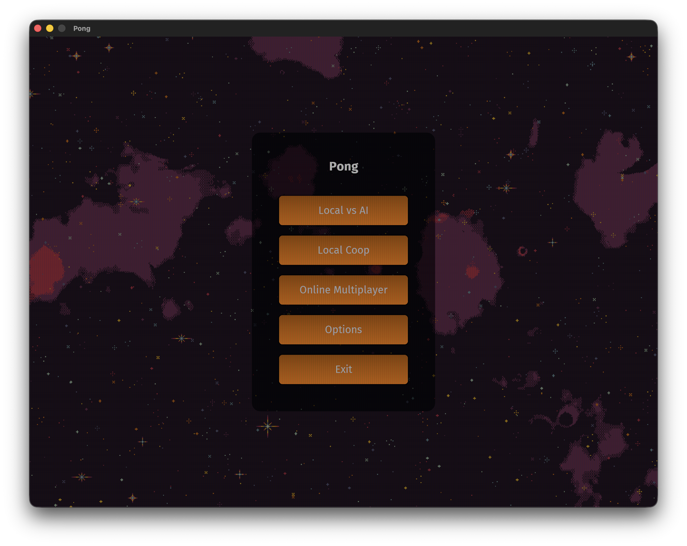
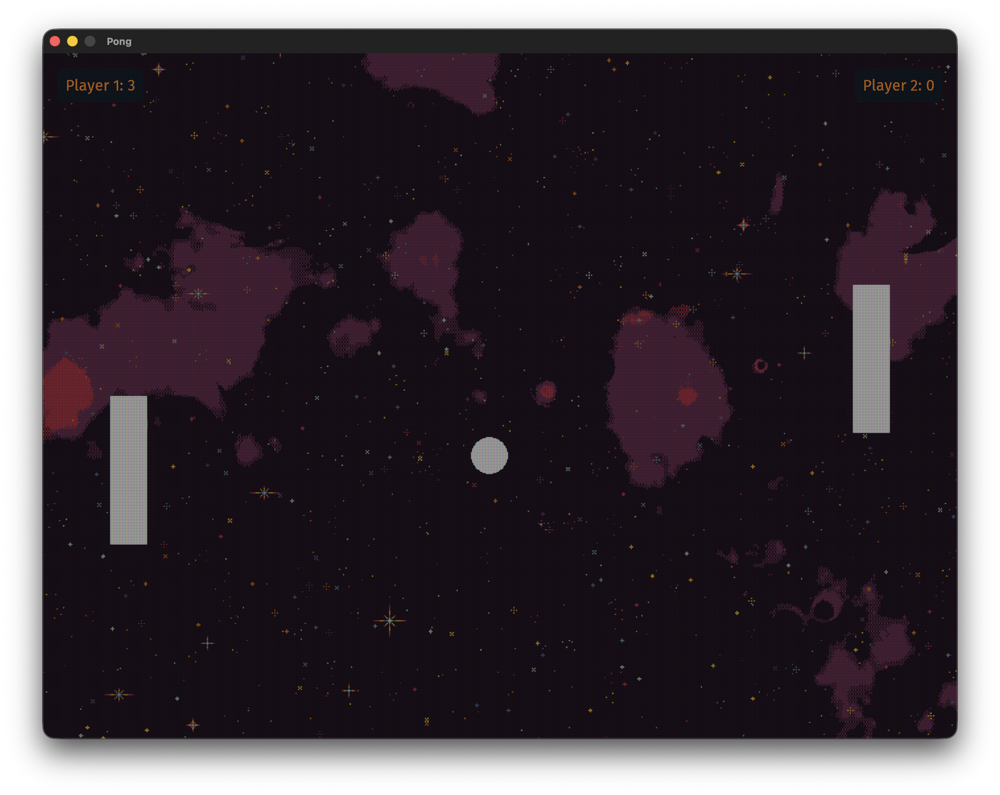

# Pong

[](https://github.com/oxylusengine/Pong/actions/workflows/xmake.yaml)

Multiplayer Pong made in [Oxylus](https://github.com/oxylusengine/Oxylus). It doubles as an example
project: a complete game whose gameplay, UI and netcode live entirely in C#, with C++ used only for
app startup and one custom render pass.

<p align="center">
  
</p>
<p align="center">
  
</p>

## Playing

Grab the zip for your platform from [Releases](https://github.com/oxylusengine/Pong/releases),
extract it anywhere and run `Pong`. Everything the game needs is inside the folder.

- **Local vs AI** / **Local Coop** — player 1 uses Up/Down, player 2 uses W/S.
- **Online Multiplayer** — one side hosts on a port, the other joins with an IP and port. Both
  players ready up in the lobby and the host starts the match. Online you drive a single paddle, so
  either key set moves it.

On macOS the build is unsigned, so clear the quarantine flag once with
`xattr -dr com.apple.quarantine Pong-macos-arm64`. On Linux you need a Vulkan driver for your GPU.

## How it works

`Pong/src` is deliberately thin. `App.cpp` builds the `ox::App` with `DefaultModules`, points
`DotNetScripting` at the scripts library next to the executable, and registers `pong::Game`, which
loads `main_scene.oxscene` and calls `runtime_start()`. The scene lists the `Pong.PongGame` scene
script, and from there C# is the game. `Game::update` also runs a CRT post-process pass over the
rendered scene, compiled from `Assets/Shaders/crt.slang` through the `game.toml` manifest into
`game.oxpack`.

The scripts are in `Pong/Assets/Scripts`, built by `Pong/Scripts/Pong.csproj`:

| Script | Role |
| --- | --- |
| `PongGame.cs` | The scene script. Reacts to the menus, runs the local lobby, starts and ends matches, and wires a match to the network session. |
| `Match.cs` | One match: the paddles (keys, AI or the online opponent), the ball, bounce angles, goals and the serve countdown. |
| `NetSession.cs` | One online game, hosted or joined: lobby state, the RPCs, and the opponent's interpolated paddle. |
| `Menus.cs` | The RmlUI document. Shows panels, lobbies, the score and the point banner, and turns every button into a `MenuAction`. |
| `Arena.cs` | Spawns the background, walls, paddles and ball with their sprites, colliders and bodies. |
| `Tuning.cs` | Tunables: sizes, speeds, the send rate and the interpolation and correction gains. |

The UI is RmlUI: `Assets/UI/ui.rml` holds every panel, `style.rcss` styles them, and `Menus.cs`
toggles which one is visible and binds the score to a data model.

### Networking

The host is a player, not a dedicated server, and it owns the simulation. Both sides exchange
[enet](https://github.com/zpl-c/enet) RPCs, declared as typed `Rpc` fields in `NetSession.cs`:

| RPC | Direction | Channel | Payload |
| --- | --- | --- | --- |
| `ready` | guest → host | reliable | guest's ready flag |
| `lobby` | host → guest | reliable | both ready flags |
| `start` | host → guest | reliable | match begins |
| `paddle` | both ways | unreliable | the sender's paddle Y |
| `ball` | host → guest | unreliable | ball position and velocity |
| `score` | host → guest | reliable | scores and who scored |
| `serve` | host → guest | reliable | ball served again |

Only the host runs goal detection, bounce angles and scoring. The guest simulates the ball itself and
steers it back onto each update from the host, snapping when it drifts too far, and plays the
opponent's paddle back between its last two reports. State goes out at 30 Hz
(`Tuning.SendInterval`).

## Building

Requires [xmake](https://xmake.io), the [Vulkan SDK](https://vulkan.lunarg.com/sdk/home), the
[.NET 10 SDK](https://dotnet.microsoft.com/download) and a C++23 compiler. Oxylus comes in as an
xmake package from the oxylus xmake-repo checked out next to this one (`../xmake-repo`). Set
`OXYLUS_SOURCE_DIR` to an absolute path to an Oxylus checkout to build the package from it.

```bash
xmake f --toolchain=clang --runtimes=c++_static -m debug
xmake build
xmake r Pong
```

Pick the toolchain for your platform (`clang-cl` on Windows, `mac-clang` on macOS, `nix-clang` on
NixOS) — see `xmake/toolchains.lua`. Modes are `debug`, `release` and `dist`.

The build publishes the C# scripts with NativeAOT into `scripts/` and copies the assets next to the
binary, so the game runs without .NET installed. Iterating on gameplay is a plain `xmake build` with
no C++ to recompile. Opening `Pong/Pong.oxproj` in the Oxylus editor builds and hot reloads the same
scripts while the scene isn't playing.

## Releases

Pushing a `v*` tag builds the release configuration for Windows, Linux and macOS and publishes the
three playable zips to GitHub Releases. Pushes to `main` build and upload the same zips as workflow
artifacts without publishing a release.
